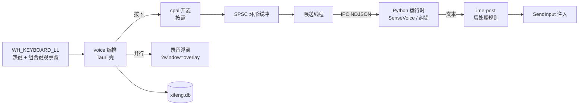

# Xifeng · 溪风

本地语音输入法（Windows）：**按住热键说话，松开就出字**，落在当前光标处。
识别、纠错、注入全程在本机完成，音频和文本不离开这台电脑。

端到端 **P95 582 ms**（硬指标 ≤ 1500 ms），基于 SenseVoice small int8 的 CPU 推理。

## 特性

| | |
|---|---|
| 按住即说 | 默认**右 Ctrl**（左右互斥）；`Ctrl+C` 等组合键在 150 ms 观察窗内直接丢弃，不会触发录音 |
| 零等待浮窗 | 按下瞬间浮窗与开麦**并行**，不串行等 WASAPI 建流；松手后音频排空再关麦 |
| 本地识别 | sherpa-onnx + SenseVoice small int8（约 239 MB），8 核 CPU 上 RTF ≈ 0.1 |
| 可选纠错 | Qwen2.5-0.5B-Instruct（GGUF，约 491 MB）；守卫拒绝删词/大改/解释性输出，宁可漏改 |
| 可靠注入 | `SendInput` Unicode 优先，必要时自动回退剪贴板并**恢复原内容**；换行用 `VK_RETURN` |
| 五页界面 | 统计 / 模型 / 配置 / 历史 / 关于，深浅色主题，Tauri 内嵌 webview |
| 托盘常驻 | 显示主界面、退出；开机自启写 `HKCU\...\Run\Xifeng` |
| 麦克风按需 | 不录音时**不占用麦克风**，按下才开流、松手就关 |

## 安装

1. 从 [Releases](https://github.com/Topskys/Xifeng/releases) 下载 `Xifeng_0.1.0_x64-setup.exe`。
2. 安装到 `%LOCALAPPDATA%\Programs\Xifeng`（安装器**默认不带模型**，安装包约 35 MB）。
3. 启动后到「模型」页下载 ASR / VAD / 纠错模型（落到用户数据目录，卸载不会删历史）。
4. 需要 WebView2 运行时（Windows 10/11 一般已自带）。

想免安装就把 `Xifeng_0.1.0_x64-portable.zip` 解压到任意目录（同样需要先有模型）。

> 首次使用请在记事本等**普通输入框**里试：终端/游戏不吃 `WM_CHAR`，需要在配置页把注入方式改成剪贴板。

## 使用

| 操作 | 说明 |
|---|---|
| 按住右 Ctrl 说话 | 开始录音，浮窗显示音量；松开发起识别并注入 |
| 录音中按 `Esc` | 取消本次，不注入 |
| 按住左 Ctrl | 不触发（左右互斥） |
| `Ctrl` + 其它键 | 不触发（组合键静默丢弃） |
| 托盘图标 | 显示主界面 / 退出 |
| 配置页 | 热键、注入策略、VAD、纠错、主题、开机自启；设置在下一次语音会话生效 |

### 数据与隐私

```
%LOCALAPPDATA%\Xifeng\
├── xifeng.db                       # 历史、设置、统计（SQLite）
├── xifeng.log                      # 只记长度与 outcome，不记识别全文
└── models\
    ├── asr\sensevoice-small-int8\  # model.int8.onnx + tokens.txt
    ├── vad\silero_vad.onnx
    └── llm\qwen2.5-0.5b-instruct-q4_k_m.gguf
```

- 音频、识别文本、剪贴板内容**不出本机**；唯一的网络请求是**模型下载**（和可选的版本检查）。
- 旧版 `VoiceIME` 的 `%LOCALAPPDATA%\VoiceIME` 会在首次启动时整目录迁移到 `Xifeng`，失败只告警不拦启动。
- 日志不落识别全文；卸载不会删除数据目录。

## 架构



- **Tauri 壳（Rust）**：热键、音频、浮窗、注入、托盘、自启、设置，全部在主进程里；音频回调只做"拷贝一块 → 入环形缓冲"。
- **Python 运行时（sidecar）**：只负责 ASR 与可选纠错，`--ipc` stdio NDJSON（`asr_begin/feed/end/cancel`），模型常驻、启动 warmup 一次。
- **Rust 扩展**：`crates/ime-post` 文本规则、`crates/ime-vad` VAD 算法，以 PyO3 模块 `xifeng_rs` 提供；Python 侧保留逐字节等价的基准实现（有 parity 测试）。

## 从源码构建

前置：Windows x64、[uv](https://docs.astral.sh/uv/)、Node/pnpm、Rust 工具链、WebView2。

```bash
# Python 侧与测试
cd spike
uv sync
uv run pytest                 # 330 个用例

# Rust 扩展（xifeng_rs.pyd）
uv run python tools/build_ext.py --release

# 内嵌 sidecar（产物：src-tauri/resources/core/Xifeng-Core）
uv run python packaging/build_core.py --clean

# 壳 + 安装器（产物：target/release/xifeng.exe、bundle/nsis/Xifeng_0.1.0_x64-setup.exe）
cd frontend
pnpm install
pnpm run tauri:build
```

开发时也可以直接跑 Python 界面：`uv run python run_spike.py --web`（五页 Web UI）或 `--tray`（托盘常驻）。

> 本仓库目录可能带 Windows **Low 完整性标签**：从这里启动的 exe 收不到硬件按键，
> 构建产物也应在复制到仓库外之后再运行/安装。详见 `docs/05-gotchas.md` G21/G24/G38。

## 目录

```
voice-ime/
├── spike/            # 交付主程序：Python 运行时、Web UI、Tauri 壳、打包脚本
│   ├── xifeng/       # ASR 运行时、后处理、注入、存储、托盘
│   ├── frontend/     # React 五页界面 + src-tauri（Rust 壳）
│   └── tests/        # 330 个用例（含 Rust/Python parity）
├── crates/           # ime-post / ime-vad / ime-py（PyO3 扩展）
└── docs/             # 架构、延迟预算、IPC 契约、打包、踩坑
```

## 文档

- 入口：[`docs/llms.txt`](docs/llms.txt)
- 延迟预算：[`docs/01-overview/latency-budget.md`](docs/01-overview/latency-budget.md)
- 架构：[`docs/01-overview/architecture.md`](docs/01-overview/architecture.md)
- IPC 契约：[`docs/03-core-concepts/ipc-contract.md`](docs/03-core-concepts/ipc-contract.md)
- 打包交付：[`docs/02-guides/packaging.md`](docs/02-guides/packaging.md)
- 踩坑合集：[`docs/05-gotchas.md`](docs/05-gotchas.md)

## 已知限制

- 仅 Windows；安装包未签名，首次运行会被 SmartScreen 提示。
- 设置热更在**下一次语音会话**生效（会话中段不变）。
- 提权窗口（以管理员运行的程序）无法注入，界面会显式提示而不是静默失败。
- 终端/游戏等不吃 `WM_CHAR` 的目标需要改用剪贴板注入。
- 模型不随安装包分发，首次使用需要联网下载。

## 致谢

[SenseVoice](https://github.com/FunAudioLLM/SenseVoice)、[sherpa-onnx](https://github.com/k2-fsa/sherpa-onnx)、
[Silero VAD](https://github.com/snakers4/silero-vad)、[llama.cpp](https://github.com/ggerganov/llama.cpp)、
[Tauri](https://tauri.app/)、[cpal](https://github.com/RustAudio/cpal)。
